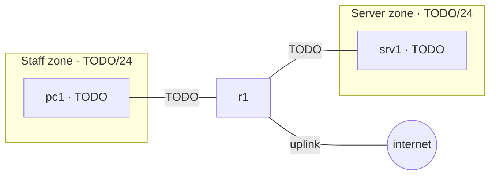

# PLAN: <your network's name>

Copy this file into your task folder as `capstone/PLAN.md`. Keep every heading, in this order, and replace each `<...>` and example line. This plan is the specification: every capstone task is checked against it.

## Need

- **Brief:** <clinic-branches | shop-cloud | centre-guest | Own pitch>
- **The network in two sentences:** <who uses it, and what it must let them do safely>
- **Users and what they must reach:**

| Group of users | Where they sit | What they must reach |
|---|---|---|
| <Reception staff> | <Main site, staff zone> | <the records server on 443, the internet> |
| <...> | <...> | <...> |

Approved by <mentor's name> on <date>

## Requirements

6 to 10 requirements. Each has one check that proves it. Mark at most 6 as **Must**; the rest are **Should**.

| ID | Requirement | Must or Should | Check that proves it |
|---|---|---|---|
| R01 | <A guest laptop gets an address and opens a web page on the internet> | Must | <`udhcpc` on guest1 gets 10.x.x.x; `curl -I https://example.com` from guest1 answers> |
| R02 | <...> | <...> | <...> |

## Hard rule

1. **The course rule:** only the paths in the access matrix are open, and every path, allowed and blocked, is tested by `tests/test-matrix.sh`. Every rule in the code carries its matrix ID.
2. **My brief's own rule:** <for example: guests never reach the server zone, by any port>

## Diagram

One `subgraph` per site or zone. Every router, firewall, server and host, with each link labelled with its subnet. Write `TODO` for addresses until task 5, then the real ones.

## Address plan

| Zone | CIDR | Gateway | Usable hosts | Devices now | Devices in 2 years | How hosts get addresses |
|---|---|---|---|---|---|---|
| <Staff> | <10.20.10.0/24> | <10.20.10.1> | <254> | <12> | <30> | <DHCP .100–.199, servers static> |
| <Spare, for a future zone> | <10.20.40.0/24> | — | <254> | 0 | — | not used yet |

Ranges: RFC 1918 for a lab build, inside your VPC CIDR for AWS. No overlap between sites, the VPN and tiers. Checked with the subnet calculator in the kit's `try-it.md`.

## Access matrix

**Block everything not listed.**

| ID | From | To | Protocol and port | Allow or Block | Why | Enforced by |
|---|---|---|---|---|---|---|
| A01 | <Staff 10.20.10.0/24> | <srv1 10.20.30.10> | <TCP 443> | Allow | <staff use the records app> | <r1 `nftables.conf`, rule `comment "A01"`> |
| A02 | <Guest 10.20.20.0/24> | <Server zone 10.20.30.0/24> | <any> | Block | <hard rule 2: guests never reach servers> | <r1 forward chain, `policy drop`, rule `comment "A02"`> |
| A03 | <...> | <...> | <...> | <...> | <...> | <...> |

Mark with **(HR)** the rows that keep your own hard rule. Every pair of zones that must not talk has at least one Block row.

## Build route

- **Route:** <Lab (containerlab) | AWS (OpenTofu)>
- **Why:** <one reason>
- **Where the code lives:** <`capstone/lab/<name>.clab.yml` and `capstone/lab/configs/` | `capstone/infra/`>
- AWS only: I run `tofu destroy` at the end of every working day, and my budget alarm is set.

## Test plan

One test per matrix row, from the row's source node, with a timeout. These become `tests/test-matrix.sh`.

| Row | Source node | Command | Expected result |
|---|---|---|---|
| A01 | <pc1> | <`nc -zv -w 3 10.20.30.10 443`> | <open> |
| A02 | <guest1> | <`nc -zv -w 3 10.20.30.10 443`> | <timeout (dropped)> |
| A03 | <...> | <...> | <...> |

## Cost estimate

**Lab:** ₹0. Laptop memory: <n> routers × about 90 MB + <n> hosts × about 3 MB = <total> MB.

**AWS:** prices for Asia Pacific (Mumbai), read on <date> from <page>.

| Item | Price per hour (USD) | Hours per day | Build days | Cost (USD) |
|---|---|---|---|---|
| <EC2 t3.micro × 2> | <...> | <...> | <...> | <...> |
| <Public IPv4 address × 1> | <...> | <...> | <...> | <...> |
| <Application Load Balancer> | <...> | <...> | <...> | <...> |
| **Total** | | | | <...> |

If I forgot to destroy it for a 30-day month (730 hours), it would cost: <sum> USD. The costliest item would be: <...>.

## Build plan

| Task | What it delivers | Requirement IDs | Hours (estimate) |
|---|---|---|---|
| CP1 task 5 | Address plan, access matrix, test plan, cost | <R..> | <2> |
| CP1 task 6 | The network as code | <R01, R02, ...> | <4> |
| CP1 task 7 | Every matrix row tested | <...> | <3> |
| CP1 task 8 | The runbook | <...> | <2> |
