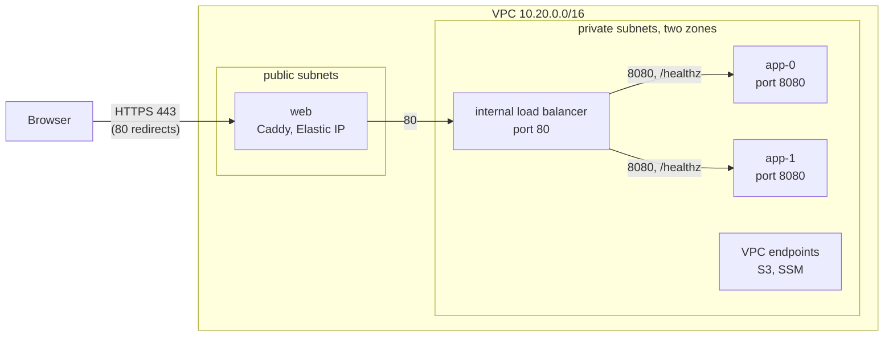

# CloudNet: the P3 app and an OpenTofu skeleton

CloudNet is the AWS network you build in P3 (weeks 6 and 7), as code. The kit gives you two things to start from:

| Folder | What it is | Copy it to |
|---|---|---|
| `app/` | The tiny web app the servers run, and the two user-data scripts that start the servers | `cloudnet/app/` |
| `tofu-skeleton/` | OpenTofu files with the provider, the state location, an instance role for Session Manager, and the budget's JSON. **No network resources**: you write those | `cloudnet/infra/` |

Before you use either, do [`setup/aws.md`](../../setup/aws.md): the budget alarm comes first.

## The design you build



- Only `web` has a public address. The load balancer is **internal** and the app servers have no public address.
- HTTPS ends on `web`: Caddy gets a Let's Encrypt certificate for your DuckDNS name. (DuckDNS can only point a name at an address, so the name cannot point at a load balancer.)
- The app servers install updates through an S3 gateway endpoint, and you reach every server through Session Manager endpoints. **There is no NAT gateway and no SSH.**
- Everything is built in steps across the P3 tasks; this picture is where you end up.

## `app/`

| File | What it is |
|---|---|
| `app.py` | The app: Python's standard library only, port 8080. `/` answers with the server's hostname, private IP address and Availability Zone (read from the instance metadata service with IMDSv2). `/healthz` answers `200 ok` for the load balancer. `/json` gives the same facts as JSON |
| `app-init.sh` | User data for the app servers: it writes a copy of `app.py` to `/opt/cloudnet/app.py` and runs it as the systemd service `cloudnet-app`. It needs no internet. Use it with `user_data = file("../app/app-init.sh")` |
| `web-init.sh` | User data for the web server, a **template**: use it with `templatefile("../app/web-init.sh", { site = ..., upstream = ... })`. It installs Docker from Amazon Linux's repositories and runs Caddy 2 as the container `caddy` (host network, volume `caddy-data` at `/data`) with the Caddyfile `<site> { reverse_proxy <upstream> }` |

Try the app on your laptop first, in Git Bash:

```bash
cd cloudnet/app
python app.py      # or: uv run --python 3.12 python app.py
```

Open http://localhost:8080: the hostname is your laptop's, and the IP and zone say `unknown`, because there is no instance metadata service on a laptop. Stop it with Ctrl+C.

Rules for the two scripts:

- **LF line endings.** A script saved with CRLF fails on the server without a clear error. VS Code's status bar must say `LF`.
- **`templatefile()` and dollar signs.** In `web-init.sh`, `${site}` and `${upstream}` are template values. Any bash variable is written `$${name}`, so the template leaves it for bash. `app-init.sh` is read with `file()`, so it has no template values.
- **If you change `app.py`, copy the change into `app-init.sh` too.** The script carries its own copy.
- `user_data` runs once, when a server first starts. To run a changed script, the server must be replaced: `user_data_replace_on_change = true` does that on the next `tofu apply`.

On a server (Session Manager shell), check them with `systemctl status cloudnet-app`, `journalctl -u cloudnet-app`, `sudo docker logs caddy` and `sudo cat /var/log/cloud-init-output.log`.

## `tofu-skeleton/`

| File | What it is |
|---|---|
| `versions.tf` | OpenTofu 1.10 or newer, the AWS provider (the version in `VERSIONS.md`), and the **local state** at `../../../cloudnet.tfstate`: the module folder, shared by every task folder |
| `provider.tf` | Region `ap-south-1` (Mumbai), profile `cloudnet-tofu`, and the tag `project = cloudnet` on everything |
| `variables.tf` | `name` (the `Name` tag prefix) and `instance_type` (`t3.micro`). Your tasks add more |
| `outputs.tf` | Empty: your tasks add outputs |
| `iam.tf` | The role `cloudnet-ssm` with `AmazonSSMManagedInstanceCore`, and the instance profile `aws_iam_instance_profile.ssm` for every server |
| `.gitignore` | `.terraform/`, `*.tfstate*`, `*.tfplan` |
| `budget.json`, `notifications-with-subscribers.json` | The budget `cloudnet-5usd` for `aws budgets create-budget` ([`setup/aws.md`](../../setup/aws.md)). **Put your own email address** in the notifications file before you use it |

First run, in Git Bash, in `cloudnet/infra/`:

```bash
export AWS_PROFILE=cloudnet
tofu init
tofu validate
tofu plan
```

`tofu plan` on the skeleton alone shows the three IAM resources to add. The budget is not in OpenTofu: you make it once with the CLI, so `tofu destroy` never removes it.

## What it costs

Prices for Asia Pacific (Mumbai), on demand, read on 24 November 2026. Check them again on the AWS pricing pages if you build much later.

| Item | Price | When it bills |
|---|---|---|
| EC2 `t3.micro` | $0.0112 an hour each | while running |
| Public IPv4 address (the Elastic IP) | $0.005 an hour | while it exists, attached or not |
| Application Load Balancer | $0.0239 an hour, plus $0.008 per LCU-hour | while it exists |
| Interface VPC endpoint | $0.013 an hour per endpoint per zone | while it exists |
| S3 gateway endpoint | free | — |
| NAT gateway (**not used**) | $0.056 an hour, plus $0.056 per GB | — |

A full CloudNet build (web, two app servers, one Elastic IP, the load balancer, three interface endpoints in one zone) is about **$0.11 an hour**, so about $0.90 for an 8-hour day, and about **$80** if you forget it for a month. On the Free plan, credits pay for it, but they run out.

**The rule: `tofu destroy` at the end of every working day, `tofu apply` the next morning.** The budget stays.

## If something goes wrong

| What you see | What to do |
|---|---|
| `NoCredentialProviders`, `ExpiredToken` or `failed to refresh cached credentials` | Your sign-in expired (up to 12 hours). `aws login --profile cloudnet`, then repeat the `tofu` command. |
| `tofu plan` wants to create everything again | You are in the wrong folder, or the state path changed. Run `tofu` in `cloudnet/infra/` inside a task folder of this module. |
| `curl` to the web server gives nothing or `502` | Wait 3 minutes after `apply`: the web server installs Docker first. Then check the `app` group allows 8080 from `web`, and both scripts have LF endings. |
| `Invalid template interpolation value` or `vars map does not contain key` | A bash variable in `web-init.sh` is written `${name}`. Write it `$${name}`. |
| `VcpuLimitExceeded` | A new account may allow fewer vCPUs. Tell your mentor, and use `count = 1` for the app servers until the limit rises. |
| A server is missing from Session Manager | It needs the instance profile, and (in a private subnet) the SSM endpoints. Reboot it after the endpoints exist. |
