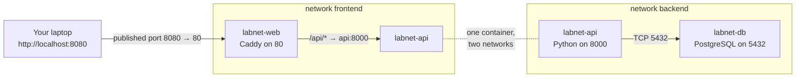

# LabNet: a three-container app on two Docker networks (P1)

LabNet is a tiny web app in three containers. You use it in P1 (weeks 2 and 3) to see addresses, routes, ports, DNS names and network isolation on real Linux machines.
Run every command on this page in the **Ubuntu (WSL) terminal**, with Docker Desktop running. Git stays in Git Bash.

## The design



| Container | Service name | Networks | Listens on | What it does |
|---|---|---|---|---|
| `labnet-web` | `web` | `frontend` | TCP 80, published on your laptop as `8080` | Caddy 2: serves the page at `/` and passes `/api/*` to `api:8000` |
| `labnet-api` | `api` | `frontend` and `backend` | TCP 8000 | A small API in Python's standard library. `/api/health` answers in JSON and says whether a TCP connection to `db:5432` works |
| `labnet-db` | `db` | `backend` | TCP 5432 | PostgreSQL 16. Nothing outside `backend` should reach it |

The rules of the design:

1. Only `web` is published to your laptop, on port 8080.
2. `web` and `api` share `frontend`. `api` and `db` share `backend`.
3. `web` can reach `api`, and `api` can reach `db`. **`web` can never reach `db`**, by name or by address.

Compare the design with `compose.yml` and with what Docker really built. They should match; your P1 tasks tell you what to do if they do not.

### Files

| Path | What it is |
|---|---|
| `compose.yml` | The three services and the two networks |
| `images/web/Dockerfile` | `labnet-web`: Caddy 2 plus the network tools |
| `images/api/Dockerfile`, `images/api/server.py` | `labnet-api`: Python 3.12 and the API's code |
| `images/db/Dockerfile` | `labnet-db`: PostgreSQL 16 plus the network tools |
| `images/tools/Dockerfile` | A plain Linux machine with the tools, used by the firewall lab |
| `web/caddy.conf` | Caddy's configuration, mounted as `/etc/caddy/Caddyfile` |
| `web/site/index.html` | The page at `/` |
| `firewall/` | The firewall lab: see [`firewall/README.md`](firewall/README.md) |

Every container has the course's Linux network tools: `ip`, `ss`, `ping`, `dig`, `getent`, `curl`, `nc` (the OpenBSD netcat), `tcpdump`, `nft`, `openssl` and `ps`.
`labnet-api` is Debian Linux. `labnet-web` and `labnet-db` are Alpine Linux. The commands are the same.

The database password in `compose.yml` is a lab-only password, written there on purpose so the lab starts with no set-up. Never reuse it, and never put a real password in a Compose file.

## Start it

```bash
cd ~/net-ess-kit/labs/labnet
docker compose up -d --build
docker compose ps
curl -s localhost:8080/api/health
```

- The first start builds three images and takes a few minutes. Later starts take seconds.
- `docker compose ps` lists `labnet-web`, `labnet-api` and `labnet-db` as `Up`.
- The `curl` prints `{"status": "ok", "service": "api", "db": "open", "db_target": "db:5432"}`: your request went laptop → web → api, and api reached db.
- Open http://localhost:8080 in your browser for the page.

If `curl` in Ubuntu cannot connect, run `curl.exe -s http://localhost:8080/api/health` in PowerShell instead.

## Look inside

Run a command in a container with `docker exec <container> <command>`, or open a shell there with `docker exec -it <container> sh` (type `exit` to leave).

```bash
docker exec labnet-api ip -4 addr          # api has two interfaces, one per network
docker exec labnet-api ip route
docker exec labnet-web ss -tulpn           # who listens on which port
docker exec labnet-web cat /etc/resolv.conf
docker exec labnet-web dig api             # Docker's DNS server answers names
docker exec labnet-web getent hosts api
docker exec labnet-api nc -z -w 3 db 5432 && echo open || echo blocked
docker network inspect labnet_frontend labnet_backend | grep -E '"Name"|Subnet|IPv4Address'
```

- Each network gets its own subnet and gateway (the `.1` address). Docker chooses them unless `compose.yml` sets them.
- Docker's DNS server answers inside each container at `127.0.0.11`. It knows the names of the containers on the **same** networks only.
- `nc -z -w 3 <name> <port>` tries one TCP connection and gives up after 3 seconds. Exit code 0 means it connected.

## Capture packets inside a container

`tcpdump` runs inside one container and sees that container's traffic:

```bash
docker exec -it labnet-api tcpdump -i any -nn tcp port 8000
```

Make some traffic from a second terminal (`curl -s localhost:8080/api/health`), then press Ctrl+C. To open a capture in Wireshark, write it to a file inside the container, then copy it out:

```bash
docker exec -it labnet-web tcpdump -i eth0 -nn -w /tmp/web.pcap port 80
docker cp labnet-web:/tmp/web.pcap .
```

Your evidence is text: the `tcpdump` lines, or Wireshark's **File → Export Packet Dissections → As Plain Text**. The kit's `.gitignore` keeps `.pcap` and `.pcapng` files out of Git.

**Safety:** capture only your own traffic and your own lab.

## Reset or stop it

```bash
docker compose up -d --force-recreate api   # a fresh api container (undoes route changes)
docker compose down                         # stop and delete the containers and networks
docker compose down -v                      # the same, and the database's data too
```

## If something goes wrong

| What you see | What to do |
|---|---|
| `Cannot connect to the Docker daemon` in Ubuntu | Start Docker Desktop. In its **Settings → Resources → WSL integration**, turn on Ubuntu (see `setup/windows.md`). |
| `port is already allocated` for 8080 or 5432 | Something on your laptop uses that port. Stop it, or ask your mentor. PowerShell's `Get-NetTCPConnection -LocalPort 8080` shows what owns it. |
| `"db": "no such name"` or `"timeout"` in `/api/health` | `api` cannot reach `db`. Check that both are on `backend` with `docker network inspect labnet_backend`. |
| After you changed `networks:` in `compose.yml`, `curl` to `/api/health` prints nothing and `getent hosts api` finds no name | `docker compose up -d` recreated the networks but reconnected the unchanged `api` without its service name. Run `docker compose down`, then `docker compose up -d`. |
| `Pool overlaps with other one on this address space` | Another Docker network uses the same subnet. Run `docker network ls`, then `docker compose down` in the other project. |
| `$'\r': command not found` or `exec format error` | A file has Windows line endings. In VS Code, click `CRLF` in the status bar, choose `LF`, save, and build again. |
| `the input device is not a TTY` | Drop `-it` for commands that need no keyboard, or run them in VS Code's Ubuntu terminal. |
