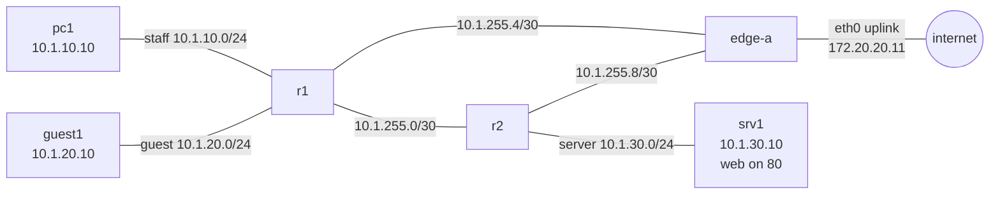

# OfficeLab: two offices as code (P2)

OfficeLab is the network you build in P2 (weeks 4 and 5): office A with two routers, an edge router and three hosts, then office B joined to it by a WireGuard tunnel.
The kit gives you the **wiring only**: which nodes exist, their images and the cables between them. Every address, route, OSPF setting, NAT rule, DHCP range, tunnel and firewall rule is yours to write, task by task.

Lab commands (`containerlab`, `docker build`, `docker exec`) run in the **Containerlab terminal** ([`setup/containerlab.md`](../../setup/containerlab.md)). Git runs in Git Bash.

## Files

| Path | What it is |
|---|---|
| `office-a.clab.yml` | Week 1: office A. Nodes `r1`, `r2`, `edge-a`, `pc1`, `guest1`, `srv1` |
| `two-offices.clab.yml` | Week 2: office A plus `edge-b` and `pc2` in office B |
| `configs/<router>/frr.conf` | Each router's FRR configuration, loaded as its `startup-config`. It holds the hostname and a `TODO` |
| `router-image/Dockerfile` | The `officelab-router` image: FRR's containerlab image plus nftables, dnsmasq, WireGuard tools, bash, tcpdump and dig |

Build the router image once, in the Containerlab terminal, before your first deploy:

```bash
docker build -t officelab-router ~/net-ess-kit/labs/officelab/router-image
```

The hosts use `wbitt/network-multitool:extra`, which containerlab downloads on the first deploy. It has `ip`, `ping`, `traceroute`, `nc`, `curl`, `dig`, `tcpdump` and `udhcpc`, and it runs nginx on port 80, so every host answers a web request. `srv1` is the one the tasks treat as the server.

## Office A



| Node | Kind | Interface | Address | Connects to |
|---|---|---|---|---|
| `r1` | FRR router | eth1 | 10.1.10.1/24 | `pc1` (staff) |
| | | eth2 | 10.1.20.1/24 | `guest1` (guest) |
| | | eth3 | 10.1.255.1/30 | `r2` eth3 |
| | | eth4 | 10.1.255.5/30 | `edge-a` eth1 |
| `r2` | FRR router | eth1 | 10.1.30.1/24 | `srv1` (server) |
| | | eth2 | 10.1.255.9/30 | `edge-a` eth2 |
| | | eth3 | 10.1.255.2/30 | `r1` eth3 |
| `edge-a` | FRR router | eth0 | 172.20.20.11 (management, set in the topology) | the internet, through the gateway 172.20.20.1 |
| | | eth1 | 10.1.255.6/30 | `r1` eth4 |
| | | eth2 | 10.1.255.10/30 | `r2` eth2 |
| | | eth3 | 198.51.100.1/30 (two offices only) | `edge-b` eth1 |
| `pc1` | host | eth1 | 10.1.10.10/24, gateway 10.1.10.1 (DHCP from task 10: 10.1.10.100–199) | `r1` eth1 |
| `guest1` | host | eth1 | 10.1.20.10/24, gateway 10.1.20.1 (DHCP from task 10: 10.1.20.100–199) | `r1` eth2 |
| `srv1` | host | eth1 | 10.1.30.10/24, gateway 10.1.30.1, always fixed | `r2` eth1 |

The local DNS name of office A is `office-a.internal`, so the server is `srv1.office-a.internal`.

## Office B and the tunnel

| Node | Kind | Interface | Address | Connects to |
|---|---|---|---|---|
| `edge-b` | FRR router | eth0 | 172.20.20.12 (management) | — |
| | | eth1 | 198.51.100.2/30 | `edge-a` eth3: the "internet" between the offices |
| | | eth2 | 10.2.10.1/24 | `pc2` |
| `pc2` | host | eth1 | 10.2.10.10/24, gateway 10.2.10.1 | `edge-b` eth2 |

| WireGuard | Value |
|---|---|
| Tunnel addresses | `edge-a` 10.99.0.1/30, `edge-b` 10.99.0.2/30 |
| Port | UDP 51820 on both edges |
| Outer addresses | 198.51.100.1 and 198.51.100.2 (the `edge-a`–`edge-b` link) |

`198.51.100.0/24` is a range set aside for documentation (RFC 5737), so it never clashes with a real network.

**Keys:** you make the WireGuard keys yourself with `wg genkey`, in a `secrets/` folder that Git ignores. A committed `wg0.conf` holds public keys only. The kit holds no keys.

## Deploy, test, destroy

In the Containerlab terminal, in your copy of `officelab/` (drive C: is `/mnt/c`):

```bash
containerlab deploy -t office-a.clab.yml --reconfigure
docker exec clab-office-a-pc1 ip -4 addr
docker exec clab-office-a-r1 vtysh -c "show ip route"
containerlab destroy -t office-a.clab.yml --cleanup
```

- Every container is named `clab-<lab>-<node>`: `clab-office-a-r1`, `clab-two-offices-edge-b`.
- `--reconfigure` makes containerlab throw away the last run and read your files again. Without it, an edit to `frr.conf` does not show.
- `vtysh -c "..."` runs one FRR command; `docker exec -it clab-office-a-r1 vtysh` opens FRR's shell (type `exit` to leave).
- FRR's containerlab image removes the management default route from the routers, so traffic only leaves a router the way your configuration says. The hosts still have one through `eth0` until you replace it with `ip route replace default via ...` in the topology.
- **One lab at a time.** Destroy office A before you deploy two offices, and destroy each broken lab before the next.

### Things worth knowing

- **Startup files and binds.** A router's `frr.conf` comes from `startup-config`. Other files go in with `binds`, for example `configs/edge-a/nftables.conf:/etc/nftables.conf`, and are loaded by an `exec:` line such as `nft -f /etc/nftables.conf`. Name nftables files `nftables.conf`, so every tool can read them.
- **DHCP on a host.** Docker mounts each container's `/etc/resolv.conf`, so `udhcpc` cannot replace it and the DNS server from DHCP never lands there. Before `udhcpc` in a host's `exec:` lines, add `umount /etc/resolv.conf`; then `udhcpc` writes the DNS server it was given. dnsmasq keeps its leases in `/var/lib/misc/dnsmasq.leases` on the router.
- **Seeing what a firewall rule matched.** Add `counter` to a rule and read the packet count with `nft list ruleset`. To see the packets themselves, use `log group 1` in the rule and watch them on the same router with `tcpdump -i nflog:1 -nn`. `log prefix "..."` on its own writes to the kernel log, which needs the extra step in [`setup/containerlab.md`](../../setup/containerlab.md).
- **WireGuard.** `wg-quick up /etc/wireguard/wg0.conf` in an `exec:` line starts the tunnel. If it says the protocol is not supported, run `sudo modprobe wireguard` in the Containerlab terminal and deploy again.

## Memory

Measured with every router running all its default daemons: about **80–95 MB per FRR router** and **3 MB per host**. Office A is about 350 MB, two offices about 450 MB, plus containerlab's own Docker engine. See the 8 GB advice in [`setup/containerlab.md`](../../setup/containerlab.md).

## If something goes wrong

| What you see | What to do |
|---|---|
| `Unable to find image 'officelab-router:latest'` or `pull access denied for officelab-router` | Build the image first (the `docker build` line above), in the Containerlab terminal. |
| A change to `frr.conf` does not show | Deploy with `--reconfigure`. |
| `Pool overlaps with other one on this address space` | Another Docker network uses 172.20.20.0/24. In the Containerlab terminal, `docker network ls` shows it; destroy the other lab. |
| `bash: $'\r': command not found`, or FRR rejects a line that looks right | The file has Windows line endings. Click `CRLF` in VS Code's status bar, choose `LF`, save, and deploy again. |
| `pc1` cannot reach a far subnet | Ping one hop at a time and check the route **back** on every router on the way. |
| No OSPF neighbour | Compare `show ip ospf interface ethN` on both ends: the area, the Hello and Dead timers, and the subnet must match. |
| Right after a deploy, neighbours say `2-Way` or OSPF routes are missing | Normal for up to a minute: routers wait about 40 seconds to elect a designated router, then exchange routes. Wait one minute, then check again. |
| After `ip link set wg0 down` and `up`, the far office stays unreachable | Taking the link down deletes the routes `wg-quick` added. Use `wg-quick down /etc/wireguard/wg0.conf` and `wg-quick up /etc/wireguard/wg0.conf` instead. |
| `wg-quick: ... Protocol not supported` | `sudo modprobe wireguard` in the Containerlab terminal, then deploy again. |
