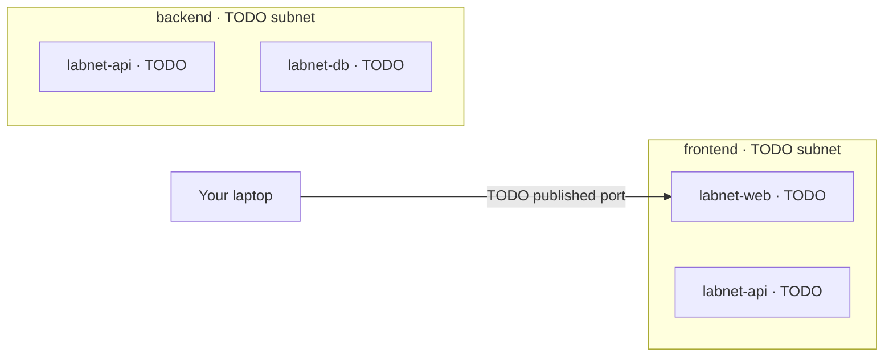

# LabNet's networks

## What was wrong

<!-- TODO(task 19): the two mistakes you found by comparing compose.yml with the design, and how you found each. -->

1.
2.

## Diagram

<!-- TODO(task 19): your real subnets, each container's address, and the published port. -->

## Why web cannot reach db

<!-- TODO(task 20): each layer that stops it, from the name lookup to Docker's firewall rules. -->
