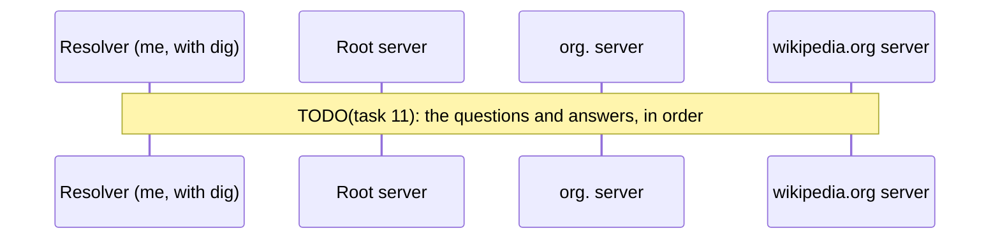

# Following a DNS lookup

## By hand, from the root

<!-- TODO(task 11): one arrow for each question and one for each answer from your `dig +norecurse` runs. Keep the participants. -->

## Caching

<!-- TODO(task 11): how the TTL changed between your two lookups, and why. -->

## Docker DNS

<!-- TODO(task 11): which server answers names inside a container, and how it knows them. -->

## A site moved

<!-- TODO(task 11): a website moved an hour ago. Why do some users still reach the old address? -->
